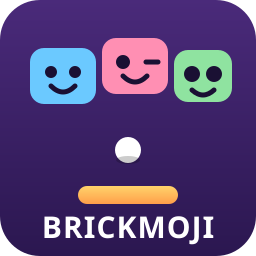

<p align="center">
  
</p>

<h1 align="center">BRICKMOJI</h1>

<p align="center">
  A tiny, playful brick-breaker for the browser — built to run as a Snapchat Web Lens.<br />
  Portrait phone viewport · Canvas 2D · TypeScript · zero runtime dependencies.
</p>

## About

Smash your way through rows of grinning, winking, starstruck bricks with a paddle
and a ball — classic Breakout/Jardinains-style arcade action, reskinned with
bitmoji-style cartoon faces instead of plain blocks. No menus, no tutorial, no
power-up inventory to manage: drag to move, tap to launch, and see how many
levels you can clear before you run out of lives.

Built with the same philosophy as its sibling project [ECHOES](https://github.com/jishanahmed-shaikh/echoes-mhcp):
small, self-contained, and shippable straight to Snapchat as a Web Lens.

## Play

**Drag anywhere to move the paddle. Tap to launch the ball.** That's the whole
control scheme — no buttons, no keyboard.

- Clear every brick to advance a level; levels get a row taller and the ball a
  little faster, up to a cap.
- Tougher bricks (a thicker outline) take two hits.
- Lose a life each time the ball falls past the paddle. Three lives, then it's
  game over — tap to retry.
- On the game-over screen, tap your score to open the Snapchat leaderboard
  (inside the Lens only).

## Run it locally

```bash
npm install     # once
npm run build    # type-check + bundle
npm run serve     # static server over dist/
# or: npm start    # build + serve in one step
```

Then open the printed `localhost` URL in a browser.

## As a Snapchat Web Lens

```bash
npm run build
npm run lens -- 1   # -> brickmoji-lens-v1.zip, checked against the Web Lens rules
```

Packs `dist/` with the Snapchat Web Lens API (leaderboard + Bitmoji) and
verifies the result against Snap's requirements — index.html at the zip root,
under the 8 MB cap, no external URLs, `viewport-fit=cover` set, the API script
loaded first. Upload the zip at My Lenses as a Web Lens.

Outside Snapchat the game plays exactly the same; the best score just lives in
`localStorage` instead of the Lens leaderboard, and the title/game-over
screens draw a cartoon face instead of your Bitmoji.

## Testing

```bash
npm test        # Vitest — collision math and level generation
```

## Architecture

```
src/
  game/       state, physics (pure, unit-tested), bricks, input, the update loop
  render/     all canvas drawing — background, bricks/faces, paddle, ball, HUD, screens
  platform/   Snapchat Web Lens integration (leaderboard + Bitmoji), localStorage fallback
scripts/      build.mjs  serve.mjs  lens.mjs
tests/        Vitest unit tests
```

One authoritative `GameState`, one `step()` function that advances it each
frame, and read-only rendering — the same single-writer pattern ECHOES uses,
just small enough here to fit in one file per concern.

## Credits

Built by [Jishanahmed Shaikh](https://github.com/jishanahmed-shaikh). Bricks,
faces, paddle, and logo are all drawn in code — no external art assets.
